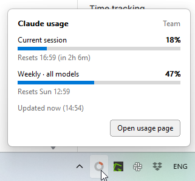

# Claude Quota Watcher

A small Windows tray app that shows your Claude plan usage. Hover over the tray icon to see:

- **Current session** % used, and when it resets
- **Weekly · all models** % used, and when it resets
- **Weekly · Fable** (and any other per-model weekly limit) % used, and when it resets
- An **Open usage page** button → https://claude.ai/new#settings/usage



## How it gets your usage

It reuses the login that **Claude Code** already keeps in
`%USERPROFILE%\.claude\.credentials.json` (or `%CLAUDE_CONFIG_DIR%\.credentials.json`).
Every minute or so it asks Anthropic's usage endpoint for your numbers. This **costs no tokens**;
it's an account-info request, not a model call.

The app only ever *reads* that file. It never refreshes or rewrites the login. Claude Code renews
the login while you use it; if Claude Code hasn't run for a few hours, the login expires and
the popup says *"Login expired — open Claude Code to renew"*. As soon as Claude Code renews it,
the app picks it up within a minute.

### How often it checks

- **Every minute** while you've looked at the popup (hovered or clicked the icon) in the last 30 minutes.
- **Every 3 minutes** after 30 minutes without a look. Hovering again switches back to every minute
  and refreshes right away.
- **Not at all** while Windows has the screen off, including sleep. It checks again as soon as the
  screen comes back on. When the screen turns off is set by your Windows power settings
  (*Settings → System → Power → Screen timeout*).

The usage endpoint is undocumented, so Anthropic may change it. If that happens the popup says
*"Usage API changed — app may need an update"*.

## Icon

The icon's orange body turns grey from left to right as the **current session** is used up:
all orange at 0%, left half grey at 50%, all grey at 100%. It updates once a minute.

### Status dot

| Dot | Meaning |
|---|---|
| none | Up to date |
| grey | Not logged in, login expired, or access denied. See **Settings…** |
| red | Couldn't reach Claude, or the usage API changed. The popup keeps the last known numbers |

## Requirements

- **64-bit Windows 10 or 11.**
- **[Claude Code](https://claude.com/claude-code), installed and logged in.** The app uses its login.

## Install

Download the executable file from the [Releases](https://github.com/oferze/claude-quota-watcher/releases) page and run it. Windows might warn about an unrecognized app. Let it run.

## Build manually

Requires Visual Studio with the C++ workload (MSVC). From the
**x64 Native Tools Command Prompt for VS**:

```bat
build.bat          :: builds bin\ClaudeQuotaWatcher.exe
build.bat test     :: builds and runs the unit tests (bin\tests.exe)
build.bat clean    :: deletes bin\ and obj\
```

`bin\tests.exe --live` makes one real request with your login and prints the parsed rows.
It never prints the token.

## Start with Windows

Press `Win+R`, type `shell:startup`, and put a shortcut to `bin\ClaudeQuotaWatcher.exe` in that folder.

## Debug flags

- `--preview`: pins the popup open after the first update
- `--settings`: opens the Settings window at startup
